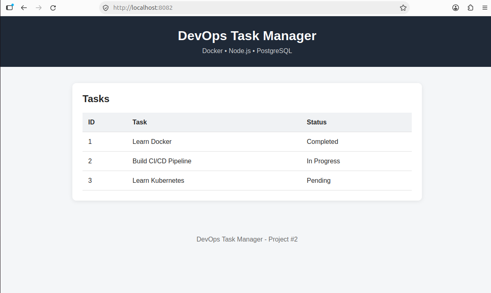
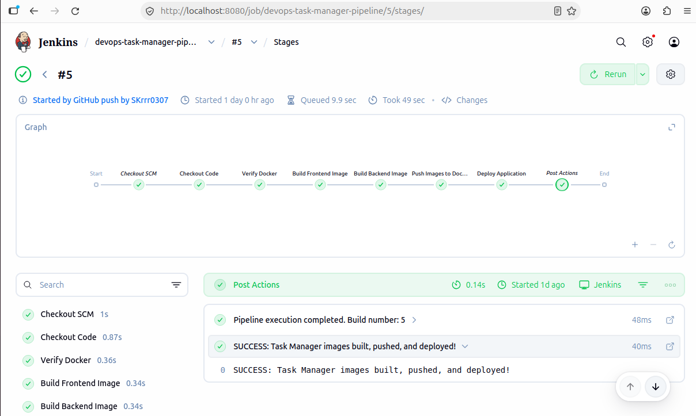
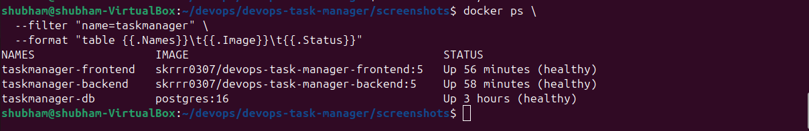
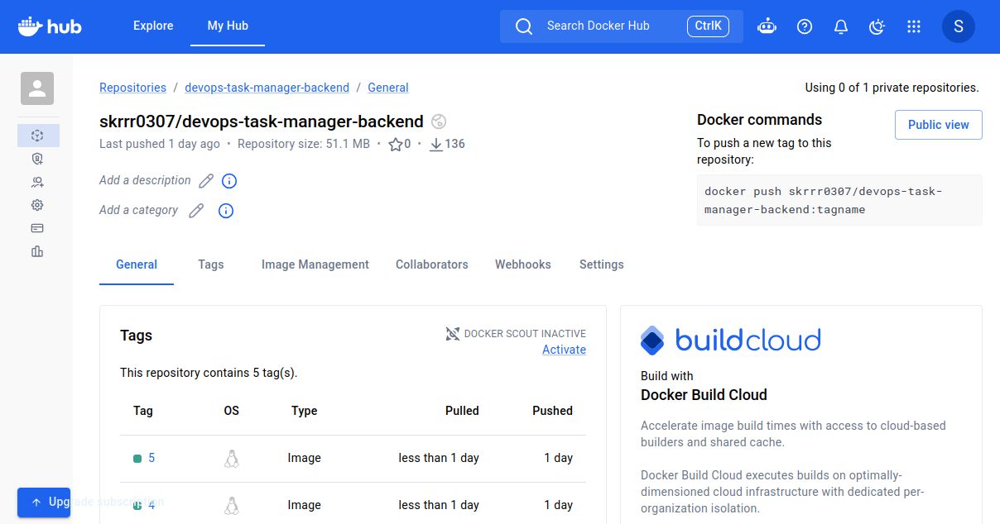
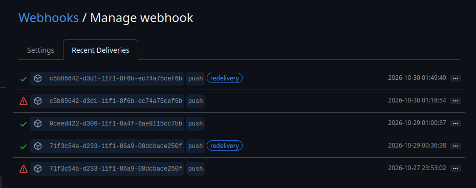

# DevOps Task Manager — Automated CI/CD Pipeline

A containerized, three-tier Task Manager application deployed using Docker Compose, with an automated CI/CD pipeline powered by Jenkins, GitHub webhooks, and Docker Hub.

This project demonstrates practical DevOps concepts, including containerization, continuous integration, continuous deployment, service health monitoring, persistent database storage, and application rollback.

## 1. Project Overview

The application consists of three services:

- **Frontend:** HTML, CSS, and JavaScript served through Nginx.
- **Backend:** Node.js and Express REST API.
- **Database:** PostgreSQL 16 for persistent application data.

All services run in Docker containers and communicate through a Docker Compose network.

A Jenkins pipeline automatically builds and publishes application images to Docker Hub and deploys updated versions whenever a configured GitHub push webhook triggers the pipeline.

## 2. Architecture

### Application Architecture

```text
                  User / Browser
                        |
                        v
                Frontend (Nginx)
                   Port 8082
                        |
                        v
                Backend (Node.js)
                   Port 3000
                        |
                        v
                  PostgreSQL
                   Port 5432
                        |
                        v
              Persistent Docker Volume
```

### CI/CD Architecture

```text
Developer
    |
    | git push
    v
GitHub Repository
    |
    | GitHub Webhook
    v
ngrok Tunnel
    |
    v
Jenkins Pipeline
    |
    +--> Checkout Source Code
    |
    +--> Verify Docker
    |
    +--> Build Frontend Docker Image
    |
    +--> Build Backend Docker Image
    |
    +--> Push Version-Tagged Images to Docker Hub
    |
    +--> Deploy Backend Using Docker Compose
    |         |
    |         +--> Wait for Backend Health Check
    |
    +--> Deploy Frontend Using Docker Compose
              |
              +--> Wait for Frontend Health Check
                        |
                        v
                Deployment Successful
```

**Note:** ngrok is used to expose the locally hosted Jenkins webhook endpoint. The tunnel must be active for GitHub to trigger Jenkins through this configuration.

## 3. Technology Stack

| Technology | Purpose |
|---|---|
| Linux (Ubuntu) | Development and deployment environment |
| Git | Source code version control |
| GitHub | Source code hosting and webhook integration |
| Jenkins | CI/CD pipeline automation |
| Docker | Application containerization |
| Docker Compose | Multi-container deployment |
| Docker Hub | Container image registry |
| Nginx | Frontend web server |
| Node.js / Express | Backend API |
| PostgreSQL 16 | Relational database |
| ngrok | GitHub-to-local-Jenkins webhook connectivity |

## 4. Project Structure

```text
devops-task-manager/
|
|-- frontend/
|   |-- Dockerfile
|   |-- index.html
|   |-- style.css
|   |-- script.js
|   `-- nginx.conf
|
|-- backend/
|   |-- Dockerfile
|   |-- .dockerignore
|   |-- package.json
|   |-- package-lock.json
|   `-- server.js
|
|-- database/
|   `-- init.sql
|
|-- docker-compose.yml
|-- docker-compose.deploy.yml
|-- Jenkinsfile
|-- .env.example
|-- .gitignore
`-- README.md
```

**Important:** Local dependencies such as `backend/node_modules/` and the private `.env` file should not be committed to GitHub.

## 5. Prerequisites

To run the application locally, you need:

- Git
- Docker Engine
- Docker Compose
- An available port `8082` for the frontend
- An available port `3000` for the backend

Jenkins, Docker Hub credentials, and webhook configuration are required only when setting up the automated CI/CD workflow.

## 6. Local Deployment

### Step 1 — Clone the repository

```bash
git clone https://github.com/SKrrr0307/devops-task-manager.git
cd devops-task-manager
```

### Step 2 — Configure environment variables

Copy the example environment file:

```bash
cp .env.example .env
```

Edit the file:

```bash
nano .env
```

Configure the PostgreSQL credentials.

Example:

```env
POSTGRES_DB=taskmanager
POSTGRES_USER=taskapp
POSTGRES_PASSWORD=your_secure_password

DB_HOST=db
DB_PORT=5432
DB_NAME=taskmanager
DB_USER=taskapp
DB_PASSWORD=your_secure_password
```

The database password must match in both `POSTGRES_PASSWORD` and `DB_PASSWORD`.

**Security:** Never commit the `.env` file or real credentials to GitHub.

### Step 3 — Build and start the application

```bash
docker compose up -d --build
```

This command builds the application images and starts the frontend, backend, and database services.

### Step 4 — Verify containers

```bash
docker compose ps
```

The services should become healthy after startup.

### Step 5 — Access the application

Frontend:

```text
http://localhost:8082
```

Backend health endpoint:

```text
http://localhost:3000/health
```

Test the backend:

```bash
curl http://localhost:3000/health
```

Expected response:

```json
{
  "status": "healthy",
  "database": "connected"
}
```

## 7. Jenkins CI/CD Pipeline

The project uses a declarative Jenkins pipeline defined in the `Jenkinsfile`.

### Pipeline Stages

**1. Checkout Code**

Retrieves the latest source code from GitHub.

**2. Verify Docker**

Checks Docker CLI availability and connectivity to the Docker Engine.

**3. Build Frontend Image**

Builds the frontend Docker image.

**4. Build Backend Image**

Builds the backend Docker image.

**5. Push Images to Docker Hub**

Authenticates using Jenkins-managed credentials and pushes version-tagged frontend and backend images.

**6. Deploy Application**

Pulls the images and updates the running application using Docker Compose.

The backend is updated first, followed by the frontend. Health checks must pass for deployment to succeed.

### Docker Image Tagging

Each Jenkins build produces images tagged with its build number.

Example:

```text
skrrr0307/devops-task-manager-frontend:5
skrrr0307/devops-task-manager-backend:5
```

Version-specific tags make it possible to identify deployments and restore earlier application versions.

### Jenkins Credentials

The pipeline uses a Jenkins credential with the ID:

```text
docker-hub-creds
```

Docker Hub credentials are stored in Jenkins rather than hardcoded in the Jenkinsfile.

## 8. GitHub Webhook Integration

GitHub webhooks automatically notify Jenkins when code is pushed.

Because Jenkins runs locally, ngrok provides a public HTTPS endpoint.

Start ngrok:

```bash
ngrok http 8080
```

Configure the GitHub webhook payload URL:

```text
https://YOUR-NGROK-URL/github-webhook/
```

Recommended webhook configuration:

- Content type: `application/json`
- Event: Push
- SSL verification: Enabled
- Webhook: Active

A successful webhook delivery triggers the Jenkins pipeline when the Jenkins job is configured with the appropriate GitHub webhook trigger.

## 9. Automated Deployment

The deployment uses two Docker Compose files:

**`docker-compose.yml`**

Defines the application services, environment variables, networks, persistent storage, and health checks.

**`docker-compose.deploy.yml`**

Overrides the frontend and backend image configuration to use version-tagged images published to Docker Hub.

### Example deployment

```bash
IMAGE_TAG=5 docker compose \
  -p devops-task-manager \
  -f docker-compose.yml \
  -f docker-compose.deploy.yml \
  pull backend frontend
```

Deploy the backend:

```bash
IMAGE_TAG=5 docker compose \
  -p devops-task-manager \
  -f docker-compose.yml \
  -f docker-compose.deploy.yml \
  up -d --no-deps --no-build --wait --wait-timeout 120 backend
```

Deploy the frontend:

```bash
IMAGE_TAG=5 docker compose \
  -p devops-task-manager \
  -f docker-compose.yml \
  -f docker-compose.deploy.yml \
  up -d --no-deps --no-build --wait --wait-timeout 120 frontend
```

### Deployment Safety

The deployment updates only the frontend and backend services.

The `--no-deps` option prevents Docker Compose from starting or updating dependent services during these commands.

The `--no-build` option prevents rebuilding application images during deployment.

PostgreSQL data is stored in a persistent Docker volume.

## 10. Application Health Checks

Docker Compose health checks are configured for all three services.

| Service | Health Check |
|---|---|
| Frontend | HTTP availability through Nginx |
| Backend | HTTP `/health` endpoint |
| PostgreSQL | `pg_isready` |

Check service health:

```bash
docker compose ps
```

Inspect container health:

```bash
docker inspect taskmanager-backend \
  --format '{{.State.Health.Status}}'
```

Health checks help identify unhealthy services and prevent the pipeline from reporting a successful deployment before the updated application containers are healthy.

## 11. Rollback and Recovery

The project supports manual application rollback using previously published Docker images.

### Tested Rollback Scenario

The following sequence was successfully tested:

```text
Build #5
   |
   | Rollback
   v
Build #4
   |
   | Recovery / Roll Forward
   v
Build #5
```

Both versions were verified through container health checks and application testing.

The PostgreSQL container ID remained unchanged throughout the process.

### Roll Back to Build #4

Pull the previous images:

```bash
IMAGE_TAG=4 docker compose \
  -p devops-task-manager \
  -f docker-compose.yml \
  -f docker-compose.deploy.yml \
  pull backend frontend
```

Roll back the backend:

```bash
IMAGE_TAG=4 docker compose \
  -p devops-task-manager \
  -f docker-compose.yml \
  -f docker-compose.deploy.yml \
  up -d --no-deps --no-build --wait --wait-timeout 120 backend
```

Roll back the frontend:

```bash
IMAGE_TAG=4 docker compose \
  -p devops-task-manager \
  -f docker-compose.yml \
  -f docker-compose.deploy.yml \
  up -d --no-deps --no-build --wait --wait-timeout 120 frontend
```

Verify:

```bash
docker compose \
  -p devops-task-manager \
  ps
```

### Restore Build #5

Repeat the deployment procedure with:

```bash
IMAGE_TAG=5
```

This restores the latest tested application version.

**Limitation:** This procedure rolls back application container images only. It does not automatically reverse database migrations or schema changes.

## 12. Troubleshooting

### Jenkins cannot access Docker

Verify Docker access:

```bash
docker exec jenkins docker info
```

Confirm that the Jenkins container has the necessary Docker CLI and Docker Engine access.

### Docker Compose deployment fails

Validate the Compose configuration:

```bash
IMAGE_TAG=5 docker compose \
  -f docker-compose.yml \
  -f docker-compose.deploy.yml \
  config --quiet
```

Check application logs:

```bash
docker logs taskmanager-backend
docker logs taskmanager-frontend
```

### Backend cannot connect to PostgreSQL

Check database health:

```bash
docker inspect taskmanager-db \
  --format '{{.State.Health.Status}}'
```

Review database logs:

```bash
docker logs taskmanager-db
```

Verify that the database environment variables are correctly configured.

### GitHub webhook does not trigger Jenkins

Check that:

1. Jenkins is running.
2. ngrok is active.
3. GitHub has the current ngrok forwarding URL.
4. The webhook endpoint ends with `/github-webhook/`.
5. The Jenkins job has the GitHub webhook trigger enabled.

### Docker disk usage is high

Check disk space:

```bash
df -h /
```

Inspect Docker storage:

```bash
docker system df
```

Avoid deleting active volumes or database storage during cleanup.

## 13. Project Validation

The following functionality has been successfully tested:

- GitHub webhook triggering Jenkins
- Jenkins pipeline execution
- Frontend and backend Docker image builds
- Docker Hub image publishing
- Automated Docker Compose deployment
- Frontend and backend health verification
- PostgreSQL connectivity
- Persistent database container preservation during deployment
- Manual rollback from Build #5 to Build #4
- Recovery from Build #4 to Build #5

**Latest validated CI/CD deployment:** Jenkins Build #5.

## 14. Project Screenshots

### 1. Task Manager Application



### 2. Jenkins CI/CD Pipeline



### 3. Docker Containers



### 4. Docker Hub Images




### 5. GitHub Webhook Integration



## 15. Future Improvements

Potential enhancements include:

- Automated rollback when deployment health checks fail
- Kubernetes-based application deployment
- Infrastructure provisioning with Terraform
- Prometheus and Grafana monitoring
- Automated application testing in the CI pipeline
- Improved secret management
- Container image vulnerability scanning

## 16. Key Learning Outcomes

This project provided hands-on experience with:

- Building and operating a multi-container application
- Writing declarative Jenkins pipelines
- Integrating GitHub webhooks with Jenkins
- Building and publishing version-tagged Docker images
- Automating application deployment
- Implementing container health checks
- Preserving database storage during application updates
- Performing controlled rollback and recovery
- Troubleshooting Docker, Jenkins, and deployment issues

---

**Project Repository:** [DevOps Task Manager](https://github.com/SKrrr0307/devops-task-manager)

**Status:** Core CI/CD deployment and manual rollback testing completed successfully.
